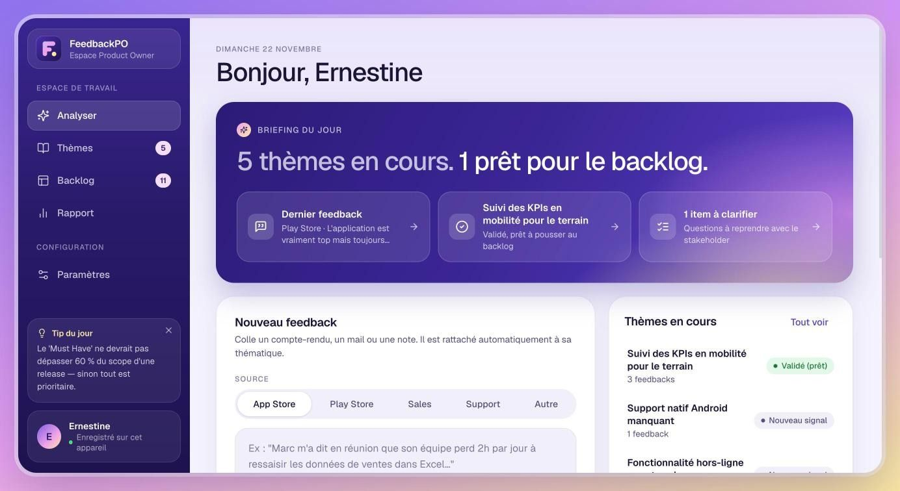
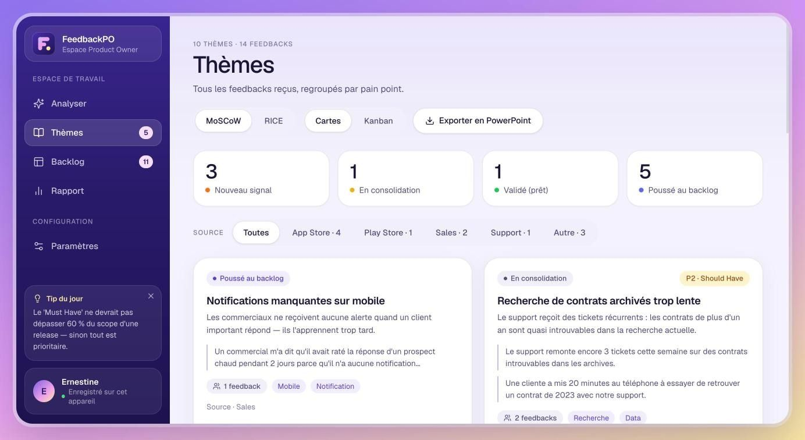
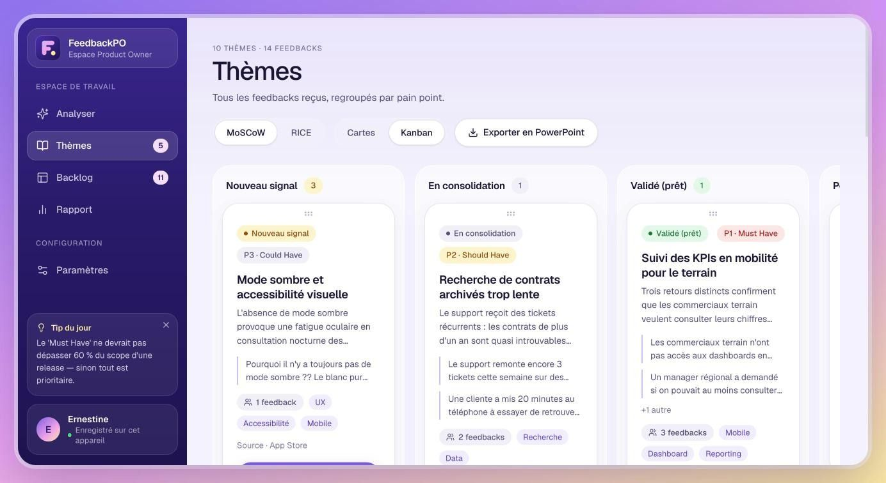
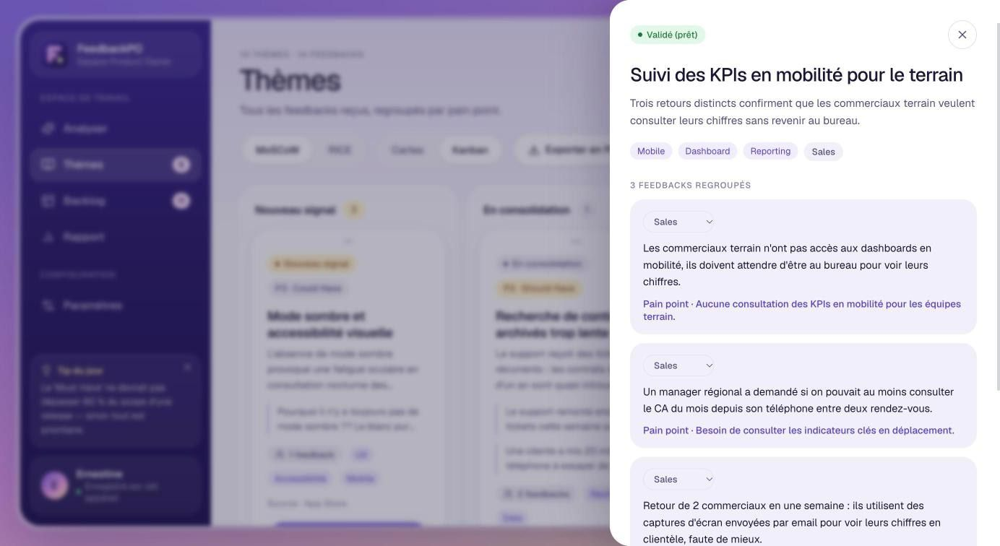
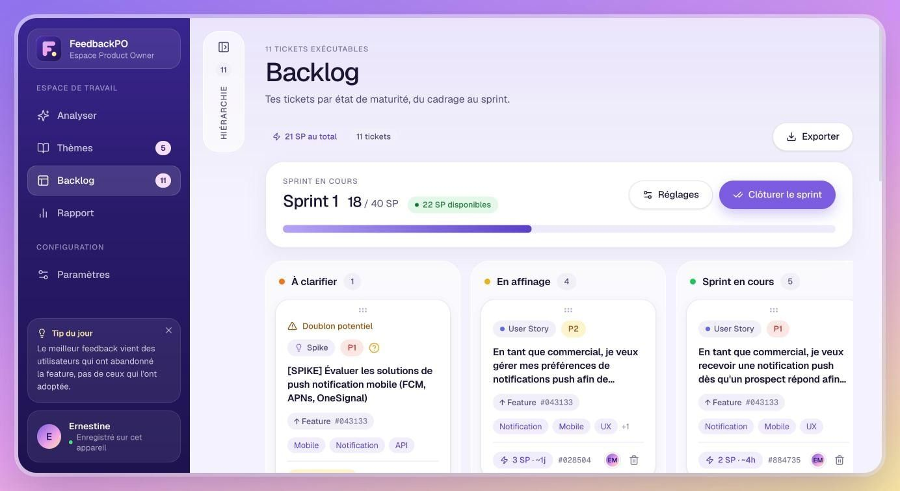
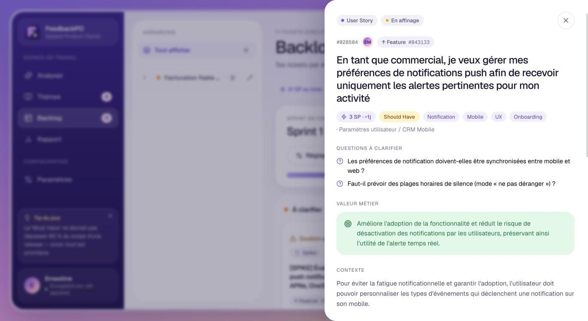
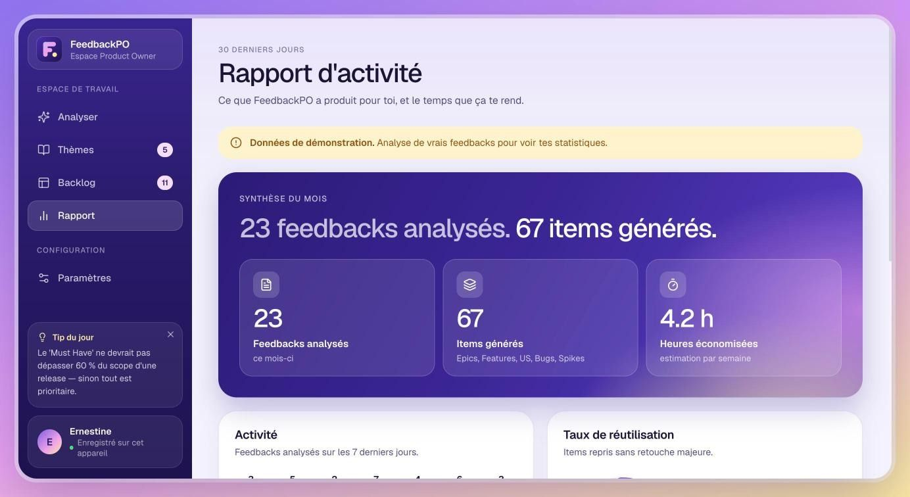
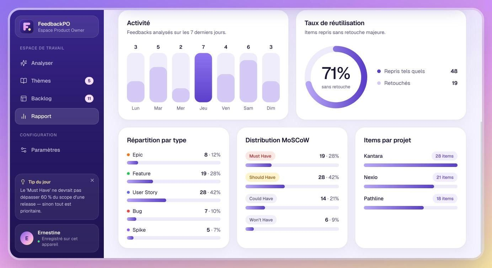
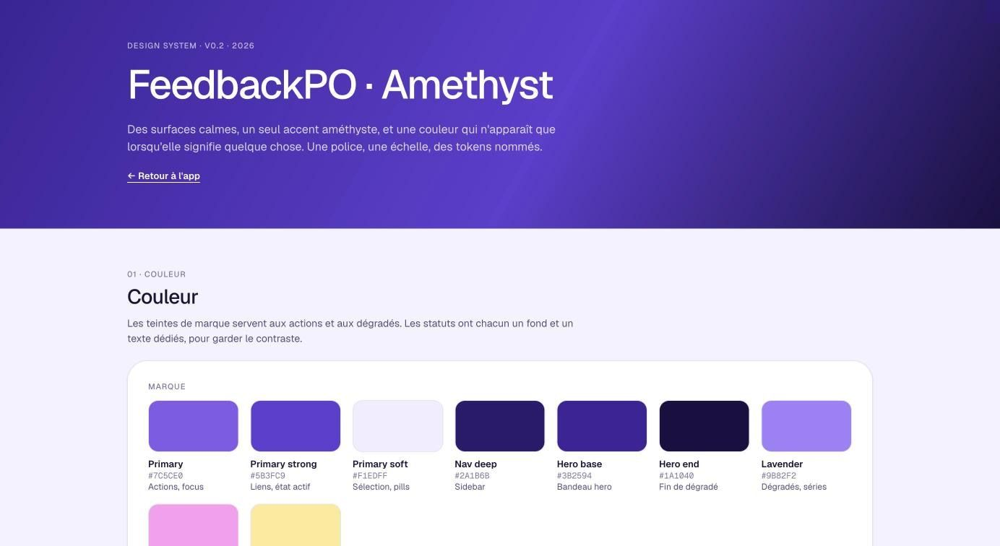
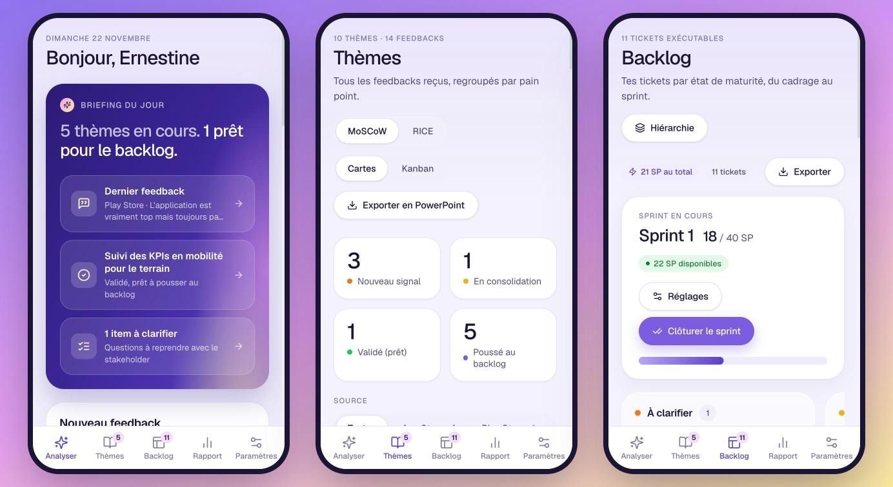

# FeedbackPO

Transforme des feedbacks bruts (utilisateurs, clients, stakeholders) en éléments de backlog structurés, grâce à un modèle de langage cadré par un prompt de Product Owner senior.

Démo : https://feedback-po.vercel.app

## Aperçu

Les captures montrent les données de démonstration intégrées à l'app (bouton « Explorer avec la démo »), pas des données réelles.



<table>
  <tr>
    <td width="50%"><br><sub><b>Thèmes</b> · regroupés par pain point, filtrables par statut et par source</sub></td>
    <td width="50%"><br><sub><b>Kanban de maturation</b> · du premier signal au thème poussé au backlog</sub></td>
  </tr>
  <tr>
    <td><br><sub><b>Détail d'un thème</b> · feedbacks sources et pain point</sub></td>
    <td><br><sub><b>Backlog</b> · états de maturité, capacité du sprint, hiérarchie repliable</sub></td>
  </tr>
  <tr>
    <td><br><sub><b>Détail d'un ticket</b> · questions à clarifier, valeur métier, critères d'acceptation</sub></td>
    <td><br><sub><b>Rapport</b> · synthèse du mois (données fictives)</sub></td>
  </tr>
  <tr>
    <td><br><sub><b>Graphiques</b> · activité, réutilisation, répartitions</sub></td>
    <td><br><sub><b>Design system</b> · tokens, typographie, composants (page <code>/#/ds</code>)</sub></td>
  </tr>
</table>

**Sur mobile** : la sidebar devient une barre d'onglets en bas.



## Le problème

Les feedbacks arrivent en vrac, mal formulés, parfois contradictoires. Les transformer en epics, features et user stories exploitables prend du temps et dépend beaucoup de la personne qui les lit.

## Ce que fait le produit

- à partir d'un feedback, génère de 1 à 4 éléments de backlog (Epic, Feature ou User Story)
- chaque élément a un titre au format en tant que / je veux / afin de, un contexte, et de 2 à 4 critères d'acceptation
- propose une priorisation avec le framework adapté (MoSCoW, RICE ou Valeur-Effort) et une justification en une phrase
- suggère le module concerné
- pose toujours 2 questions de clarification à reprendre avec le stakeholder
- signale les feedbacks trop vagues au lieu de les interpréter
- permet de copier chaque élément pour le coller dans l'outil de backlog

## Décisions produit et garde-fous IA

- la sortie est un JSON strict, ce qui rend le résultat exploitable par l'interface et vérifiable
- le prompt interdit d'inventer des fonctionnalités non mentionnées dans le feedback
- un champ d'ambiguïté permet de ne pas forcer une réponse quand le feedback est insuffisant
- les questions de clarification sont systématiques : l'IA prépare la discussion, elle ne remplace pas le PO

## Limites actuelles

Prototype (MVP). La qualité dépend du prompt et du modèle, et chaque élément généré reste à relire et à arbitrer par un humain.

## Configuration de la clé API

La clé Anthropic reste **côté serveur** : le navigateur appelle `/api/claude` (fonction Vercel dans `api/claude.js`), qui ajoute la clé et relaie la requête. Ne jamais nommer cette variable avec le préfixe `VITE_` : elle serait incorporée au code public.

- En local : copier `.env.example` en `.env` et renseigner `ANTHROPIC_API_KEY`, puis `npm run dev` (Vite relaie `/api/claude`).
- En production : définir `ANTHROPIC_API_KEY` dans Vercel (Settings > Environment Variables).

Le proxy n'accepte que la même origine, deux modèles, `max_tokens` plafonné à 4096 et 20 000 caractères d'entrée.

### Limites d'usage

Des quotas protègent ton crédit Anthropic (`api/_ratelimit.js`), comptés dans Upstash Redis. Un appel léger vaut 1 unité, un push vers le backlog (Sonnet, sortie longue) en vaut 5.

| Plafond | Par défaut | Variable |
|---|---|---|
| Par personne et par heure | 25 unités | `LIMIT_IP_HOUR` |
| Par personne et par jour | 50 unités | `LIMIT_IP_DAY` |
| Global par jour (UTC) | 400 unités | `LIMIT_GLOBAL_DAY` |

- Mise en place : ajouter l'intégration **Upstash Redis** depuis le Marketplace Vercel (elle crée `KV_REST_API_URL` et `KV_REST_API_TOKEN`), puis redéployer.
- Sans compteur disponible, le proxy **refuse** les appels (503) plutôt que de les laisser passer.
- Les adresses IP sont hachées avant stockage. Les compteurs expirent seuls.
- Le mode démo n'appelle pas l'IA : il reste utilisable quand un quota est atteint.
- Ces limites réduisent le risque, elles ne le suppriment pas : fixe aussi un plafond de dépense mensuel dans la console Anthropic.

## Technique

React, Vite, lucide-react.

```
npm install
npm run dev
```
